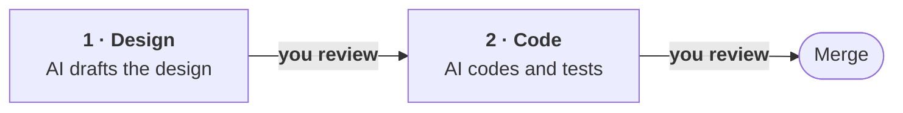

# MedHarness

**A change-control gate for medical-device software written with AI coding agents.
Your agent writes the code and the design record that IEC 62304 asks for; ordinary
code — never a model — checks that the two agree before a change can merge.**

[](https://pypi.org/project/medharness/)
[](LICENSE)
[](https://python.org)

## The problem

IEC 62304 asks that every change to medical-device software leave design-control
evidence: the requirements, risks, design and tests it touched, each traced to the
next, in a Design History File (DHF). With an AI agent writing the code, that evidence
has two usual sources, and neither holds up:

- **Written by people after the fact.** Slow and expensive, and it drifts from the code.
- **Generated by the agent along the way.** Cheap, but nobody can be sure it is complete
  or true.

MedHarness keeps the DHF in your git repository, one YAML file per item, and checks it
the way a build is checked: by code, on the branch, before the merge.

## What it catches

A change request (CR) declares what it changes. The check compares that with what the
branch did. Here the branch edited a requirement the CR did not list, and a design that
depends on it was neither updated nor reviewed:

```
$ medharness verify impact --cr CR-004
FAIL [impact] dhf_branch: The branch changes SRS-001 since main, but CR-004 does not list them in affected_items.
    Fix: Add them: medharness item update CR-004 --data '{"affected_items": [...]}' — or revert the changes this CR should not make.
FAIL [impact] impact.SWDD-001: SWDD-001 depends on SRS-001, which this branch changes, but SWDD-001 is neither changed nor listed in CR-004's reviewed_items.
    Fix: Update SWDD-001 to follow the change, or if it needs none run `medharness item update CR-004 --data '{"reviewed_items": [..., "SWDD-001"]}'`.
```

The same family of checks stops a requirement with no passing test, a link to an item
that does not exist, and a SOUP component the register does not list. Every failure
names the item and the field to fix.

## What you get

- **A DHF that agrees with the code**, because the check runs on the branch, in the
  review that merges it.
- **Release evidence generated, not assembled:** the specifications, a traceability
  report for each matrix, the test evidence, a software BOM and a CycloneDX SBOM, a
  manifest hashing every file, and, when you sign, an approval sheet of who approved which
  documents.
- **An AI agent whose change can be challenged:** whether a CR's declared impact is
  complete is checked by code, and the agent's design is reviewed by you before any code
  is written.

## Who it is for

Small teams (one to ten people) building medical software with AI coding agents, with
little quality or regulatory capacity of their own, and the auditors who read what they
produce. It covers IEC 62304 and the part of ISO 14971 that a change touches.

It is not a quality management system (no CAPA, training, suppliers or complaints), it
does not judge whether a clinical or risk conclusion is right (it makes the conclusion
visible and open to challenge), and it has no editing UI. [charter.md](docs/charter.md)
has the promises and the non-goals.

## How it works



For each change request, the agent **designs** first — it assesses the change's
risk, then writes the requirements, design and test points it needs as items in
the DHF, each traced to the next — and **codes** second, tagging each test with
the requirement it verifies. You review the design, then the code. Between them,
the checks confirm that the design traces, every requirement is verified, and the
branch changed what the request said.

`init` writes an `AGENTS.md` (and a `CLAUDE.md` that imports it) telling your
agent when to open a change request and which commands to run; it reads and
writes the DHF through `medharness item`, which refuses a bad edit. What to call
when is in [Working with your coding agent](docs/agents.md).

Two ways to run it:

- **At your desk**, with the agent you already use: it works in your tree and you commit.
- **Unattended**, from an issue: CI opens the change request and a pull request with
  the design, revises on review, then does the code the same way
  ([recipe](docs/ai-workflow.md#wiring-it-into-github-actions)). This runs an agent
  with a shell: use an ephemeral runner and read [ai-security.md](docs/ai-security.md) first.

## Quick start

Python 3.11 or newer.

```bash
pip install medharness
mkdir my-device && cd my-device
medharness init            # writes DHF/ with sample items, and AGENTS.md for your agent
```

Then ask your coding agent: *"open a CR for PDF export and implement it"*.
Or use the checks alone, with no AI: `medharness verify dhf` checks that the
design holds together.

## What a project looks like

```
my-device/
├── DHF/
│   ├── config/global.yaml       # the project name — and only what you change
│   └── items/                   # one YAML file per item, one directory per type
│       ├── 01_crs/CRS-001.yaml
│       ├── 03_srs/SRS-001.yaml
│       └── …
├── AGENTS.md                    # product context and DHF steps, for any coding agent
└── CLAUDE.md                    # @AGENTS.md, so Claude Code reads it too
```

The item types, their lifecycles and the specification templates ship in the
package; a project overrides only what it changes
([configuration.md](docs/configuration.md)). An item is a small YAML file, with
links written on the child and pointing up:

```yaml
id: SRS-012
title: Password must be at least 12 characters
derives_from: [SYS-004]
verification_method: [Test]
testing: |
  T1: an 11-character password is rejected
```

One CLI, `medharness`, in four groups: `item` reads and changes items, `verify`
checks and writes nothing, `build` produces items, code and release artifacts,
`init` scaffolds. What each command does, prints and exits with is in
[interface.md](docs/interface.md); `--help` lists its options.

[ContourLab](https://github.com/itercharles/ContourLab) is a browser-based contouring workspace for radiation oncology
on which MedHarness is exercised end to end; its DHF and CI are a worked example.

## Documentation

| | |
|---|---|
| [adopting.md](docs/adopting.md) | starting fresh or bringing an existing DHF |
| [ci.md](docs/ci.md) | the CI recipe, cutting and signing a release |
| [ai-workflow.md](docs/ai-workflow.md) | a change request from design to code |
| [agents.md](docs/agents.md) | working with your coding agent |
| [soup.md](docs/soup.md) | the SOUP register, SBOM, vulnerability scanning |
| [configuration.md](docs/configuration.md) | changing the defaults |
| [interface.md](docs/interface.md) | what a script or pipeline can rely on |
| [validation.md](docs/validation.md) | the tool's own validation |
| [ai-security.md](docs/ai-security.md) | what the AI stages can do |
| [architecture.md](docs/architecture.md) | how the code is organised |
| [charter.md](docs/charter.md) | what it is for, and what it does not do |
| [CHANGELOG.md](CHANGELOG.md) | version history |

## License

MIT. See [LICENSE](LICENSE).
